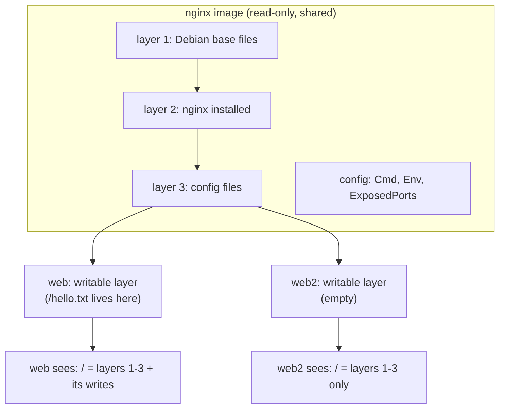
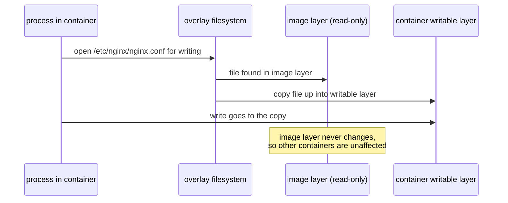
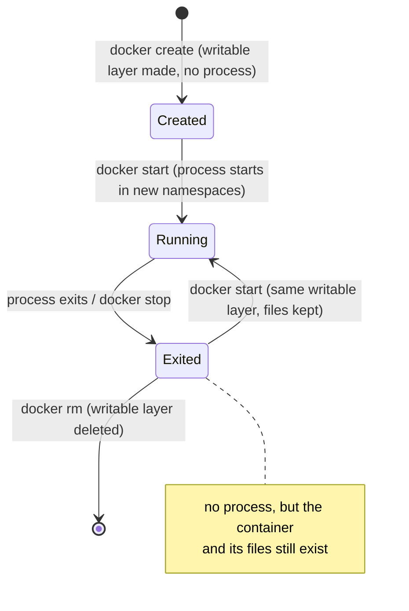

# Docker: diagrams

## Image vs container: layers

Two containers share the same read-only image layers. Each gets its own thin writable layer.
Overlay filesystem stacks them into one view, which becomes the container's `/`.

## Copy-on-write: what happens when a container edits a file from the image

## Container lifecycle

